

  <picture></picture>
  <picture></picture>

<picture>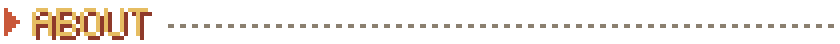</picture>

<picture>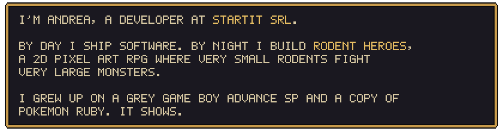</picture>

<picture>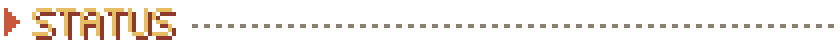</picture>

<picture>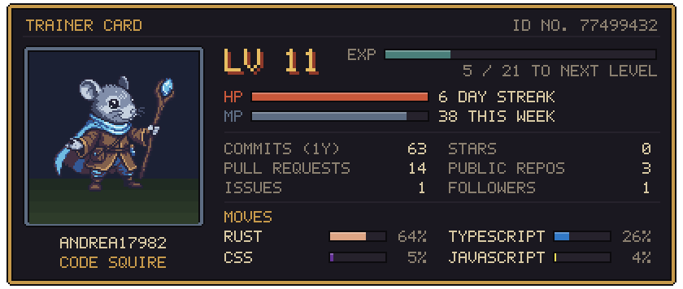</picture>
<picture></picture>

<picture>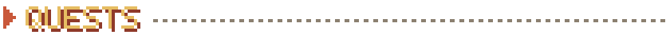</picture>

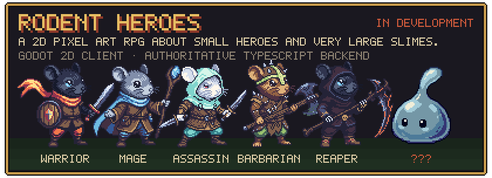
<a href="https://github.com/Andrea17982/Lumen">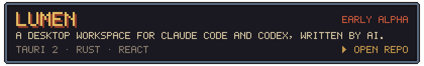</a>

<picture>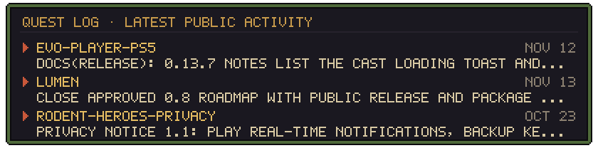</picture>

[All repositories →](https://github.com/Andrea17982?tab=repositories)

<picture>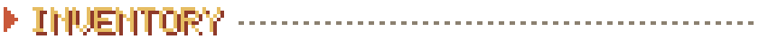</picture>

<picture>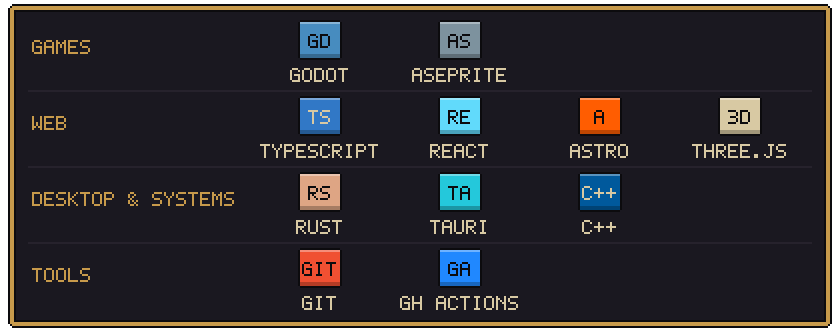</picture>

<picture>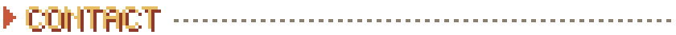</picture>

- Telegram: [@Andrea17982](https://t.me/Andrea17982)
- Portfolio (work in progress): [portfolio-one-dun-37.vercel.app](https://portfolio-one-dun-37.vercel.app)

<picture></picture>

Heroes and enemies are sprites from Rodent Heroes, © Andrea Nastro. Everything else on this page is drawn by
<a href="scripts/generate.mjs">a script</a> that a GitHub Action runs every few hours: the sky follows the time of day in Italy, the enemy changes daily, the stats are live.
